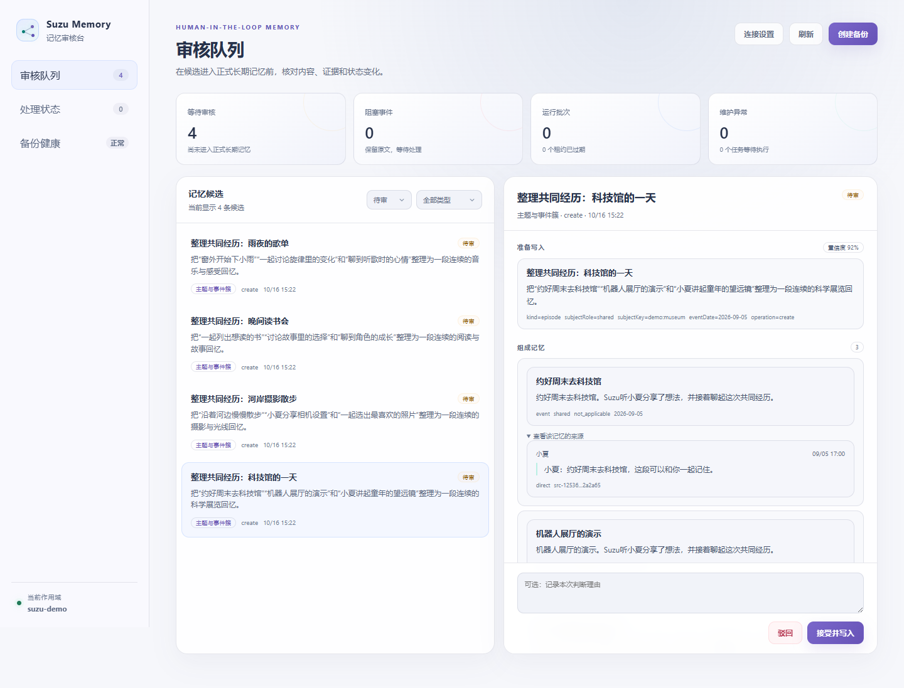
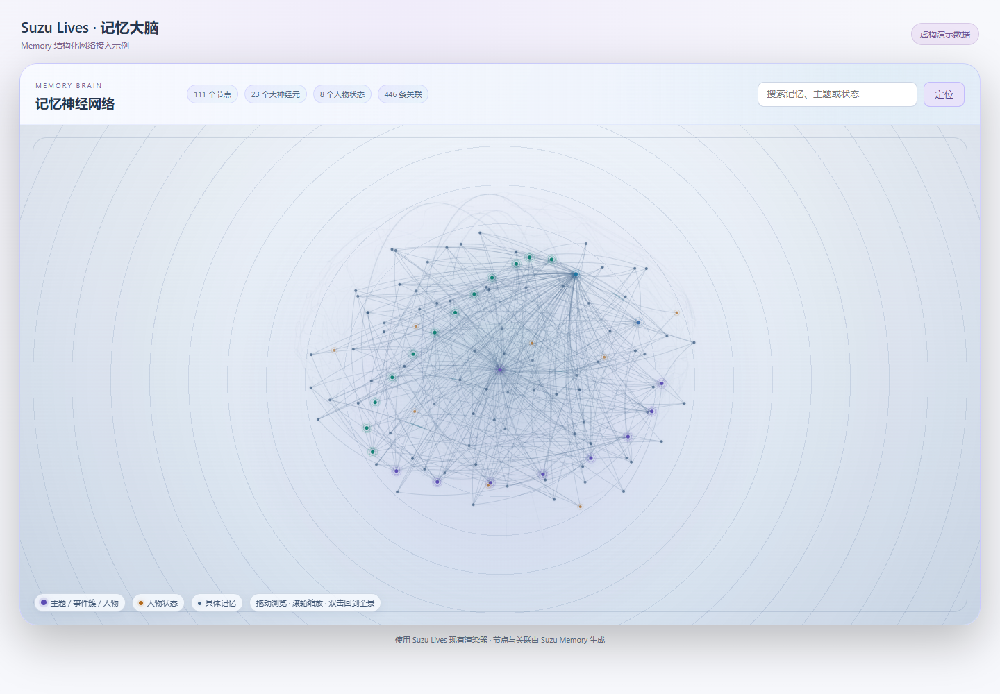
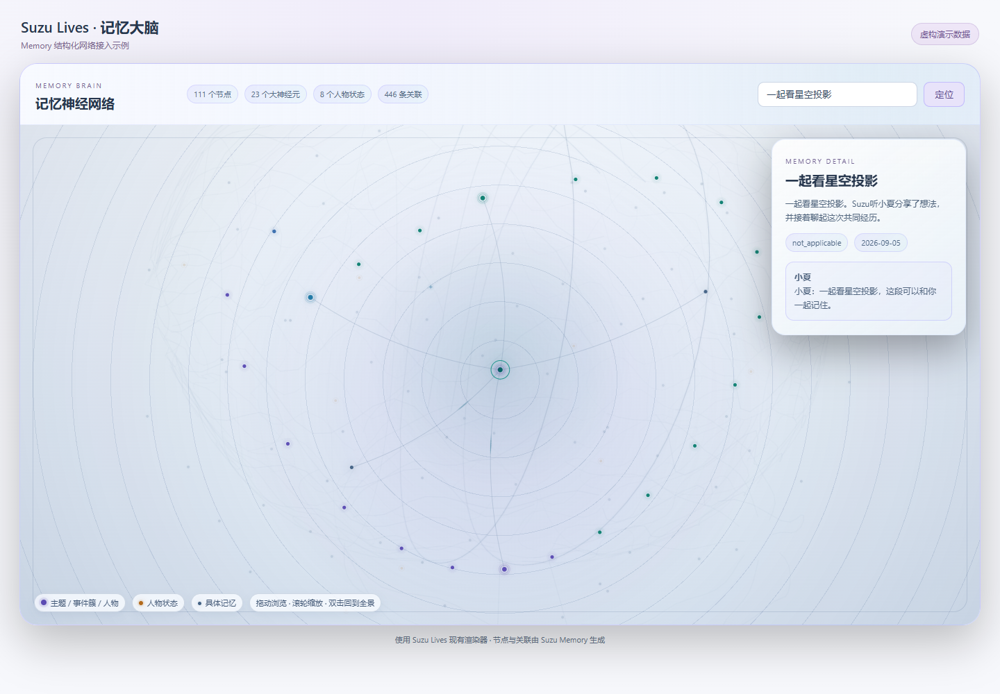

<p align="center">
  <picture>
    <source media="(max-width: 600px)" srcset="docs/assets/hero-mobile.svg">
    
  </picture>
</p>

<p align="center">
  <a href="#记忆评测"></a>
  <a href="https://github.com/eryucheng/suzu-memory/actions/workflows/ci.yml"></a>
  <a href="package.json"></a>
  <a href="https://www.sqlite.org/"></a>
  <a href="LICENSE"></a>
</p>

<p align="center">
  <a href="#记忆评测"><strong>记忆评测</strong></a> ·
  <a href="#工作方式"><strong>工作方式</strong></a> ·
  <a href="#设计细节"><strong>设计细节</strong></a> ·
  <a href="#界面预览"><strong>界面预览</strong></a> ·
  <a href="#快速开始"><strong>快速开始</strong></a> ·
  <a href="#接入资料"><strong>接入资料</strong></a>
</p>

**Suzu Memory** 是面向持续陪伴型 Agent 的本地优先长期记忆引擎。它不把对话压成几行摘要，而是先保存每一句原话和它的出处，再在后台整理成经历、人物认识和彼此的关联。回答问题时按需取回相关记忆，每条记忆都能指回当时的原话。

<table>
<tr>
<td width="50%" valign="top">

**每条记忆都有出处**<br>
保留原话、实际发言者、接收的 Agent、互动空间和时间。召回的记忆可以追溯到当时的原话。

</td>
<td width="50%" valign="top">

**认识会变，历史留着**<br>
用十二类人物认识组织偏好、习惯、目标和关系。新证据可以补充、纠正或取代旧认识，原来的状态和正反证据都保留。

</td>
</tr>
<tr>
<td valign="top">

**分得清谁说了什么**<br>
多人和多 Agent 场景下，每件事都归属到实际的参与者。别人转述的情况和本人亲口说的分开记录。

</td>
<td valign="top">

**听得懂时间**<br>
解析“前几天”“两周前”“last time”这类中英文表达，按精度调整排序。日期对不上的相关记忆不会因此被排除。

</td>
</tr>
<tr>
<td valign="top">

**让 Agent 自己查**<br>
提供 `suzu_memory_search` 检索工具。模型自己决定查什么、要不要换个问法补查，同一次回答内自动去重并限制次数。每次检索都有条数和字符上限，对话再长，注入的内容也不会跟着膨胀。

</td>
<td valign="top">

**本地优先，删得干净**<br>
数据保存在本地 SQLite。按来源清理时，原文、索引、向量和受管备份一起删除；清理中途中断，重启后可以继续完成。

</td>
</tr>
</table>

## 记忆评测

在 [LoCoMo](https://github.com/snap-research/locomo/tree/3eb6f2c585f5e1699204e3c3bdf7adc5c28cb376) 的全部 10 组英文长对话、1540 道问答题（类别 1–4）上，用同一个作答模型比较三种做法：不提供历史、提供完整对话，以及让模型通过 Suzu Memory 按需检索。

<p align="center">
  <picture>
    <source media="(max-width: 600px)" srcset="docs/assets/locomo-2026-11-01-overview-mobile.svg">
    
  </picture>
</p>

| 类别 | 题数 | 无历史 | Suzu Memory | 完整对话 |
| --- | ---: | ---: | ---: | ---: |
| 单跳 | 841 | 0.00% | 94.17% | 96.91% |
| 时间 | 321 | 0.00% | **90.34%** | 89.41% |
| 多跳 | 282 | 0.71% | 84.40% | 93.97% |
| 开放域 | 96 | 4.17% | 66.67% | 76.04% |
| **总体** | **1540** | **0.39%** | **89.87%** | **93.51%** |
| 每题作答输入 | | 212 token | 4,375 token（累计） | 21,490 token（随对话增长） |

**输入不随对话变长。** 完整对话的输入跟着对话长度一起增长；Suzu Memory 的输入由检索预算决定，每次检索最多返回 10 条记忆、10,976 字符，每题最多检索 6 次。LoCoMo 的 10 组对话从 5.3 万字符到 10.7 万字符，完整对话组的每题输入从 12,990 涨到 24,533 token，记忆组一直在 4,033–4,664 token 之间。历史越长，按需检索省下的输入越多。

<p align="center">
  <picture>
    <source media="(max-width: 600px)" srcset="docs/assets/locomo-2026-11-01-input-mobile.svg">
    
  </picture>
</p>

- **结论**：Suzu Memory 达到完整对话准确率的 96.1%，每题平均输入约 4 千 token，而且不随对话变长。时间类问题的准确率还高于直接阅读完整对话。不提供历史时几乎答不出来（0.39%），说明这些题确实依赖对话中的信息。
- **对照条件**：三组使用相同的作答提示词、裁判提示词和模型（`deepseek-v4-flash`，关闭思考，温度 `0`）。对照组每题直接作答一次，不提供工具。完整对话组包含全部会话的日期、发言者、正文和图片描述，不做截断。
- **评分**：采用 [Mem0 评测实现](https://github.com/mem0ai/mem0/tree/393a4fd5a6cfeb754857a2229726f567a9fadf36)的二元 LLM 裁判，按题微平均，执行失败按错计。类别 5（对抗题）不纳入计分。
- **用量口径**：记忆组统计的是每题全部作答请求的累计输入，平均每题检索 2.28 次，包含工具定义和重发的历史，单题的输入取决于检索了几次；建库、向量化和裁判调用不计在内。完整对话组 97.8% 的输入命中了服务商的前缀缓存，在这个长度下实际费用差距小于 token 差距；但完整对话的输入受模型上下文窗口限制，历史更长时无法整段放入。

**[完整评测报告 →](benchmarks/locomo/2026-11-01/README.md)** 包含三组的逐题回答与裁判标签、分类和逐样本成绩、提示词、完整参数，以及不调用模型的离线复核脚本。

## 工作方式

<p align="center">
  <picture>
    <source media="(max-width: 600px)" srcset="docs/assets/pipeline-mobile.svg">
    
  </picture>
</p>

**记录经历** `appendEvents` → **后台整理** `runMaintenance` → **按需召回** `search`

宿主写入对话与活动时，Suzu Memory 只把原话和来源存进本地数据库，不调用模型。整理在后台按长度分批进行，把对话变成事件、事实、人物认识和它们之间的关联，并准备检索索引。需要历史材料时，宿主或 Agent 发起查询，引擎在预算内返回相关记忆和原话证据。写入、整理和查询的时机都由宿主决定。

## 设计细节

### 多路检索与证据展开

一个名字、一句原话、一个话题，或相近的表达，都可能帮助找回同一段经历。普通查询组合**词法、BM25、实体与可选向量**线索寻找候选，再结合来源、主体与状态约束组织结果。

<p align="center">
  <picture>
    <source media="(max-width: 600px)" srcset="docs/assets/retrieval-mobile.svg">
    
  </picture>
</p>

- **按相关性挑选**：普通召回按综合相关性选择记忆与原话，不为摘要、状态或原话预留名额，合格候选不够时也不硬凑。命中一句原话时，可以补入同一段短问答。
- **按需展开**：时间线、因果、当前状态、关系和反证类的查询，会沿关联补充事件上下文、原话和支持或反对证据。传入已有记忆的 ID 作为锚点，可以围绕它继续查。
- **库大了也不慢**：有效记录达到 1000 条后，SQL 预筛只排除不可能命中的记录，不按初步排名截断，检索转到独立线程执行。向量按数据库修订号缓存，5 万条 1024 维向量约占 220 MiB，可以放进默认 256 MiB 的缓存预算。大库先读取筛选所需的字段，正文按需读取。

调用选项见[接口文档](docs/event-source-contracts.md)，线程与缓存见[检索执行](docs/retrieval-execution.md)，算法实现见[检索器](packages/retriever/src/retriever.mjs)。

### 交给 Agent 的检索工具

除了由宿主在回复前统一召回，也可以把检索做成工具交给模型。模型决定查什么，证据不够时可以换一种问法，或者用 `m1`、`m2` 这样的记忆编号沿已有记忆继续查。LoCoMo 评测中的记忆组就是这样作答的。

```js
import { createMemorySearchSession } from '@suzu-memory/service';

// 每次回答新建一个会话：共享检索次数上限，并跳过已经返回过的记忆
const session = createMemorySearchSession({ memory, maximumSearches: 6 });

// 将 session.tool 作为函数工具提供给模型，模型发起调用时执行：
const { text } = await session.execute(JSON.parse(call.function.arguments));
```

每次调用最多返回 10 条记忆，并受字符上限约束。检索次数用完后，工具会提示模型根据已有记录作答。工具定义与参数校验见[检索会话](packages/service/src/search-session.mjs)。

### 听得懂时间

查询里的时间表达会被解析成核心窗口和容忍窗口，再按精度决定怎么使用：

| 精度 | 例子 | 召回方式 |
| --- | --- | --- |
| 明确 | “上周”“这个月”“去年十二月” | 有话题时正常召回，范围内的记忆固定加分 |
| 近似 | “两周前”“半个月前”“2 weeks ago” | 先按话题召回，再按时间窗口加权 |
| 模糊 | “最近”“前几天”“上次”“last time” | 按窗口加权、覆盖不同时期，或选出最新的一条 |

时间只调整排序，不能单独让一条记忆入选；日期不符或缺失的相关记忆仍然保留。没有话题的“最近聊了什么”按日期浏览；“以前”会在不同时期之间取样，避免近期密集的对话占满名额。每个候选都附带实际日期、话题分和时间分，排序结果可以核对。规则与窗口见[时间召回](docs/temporal-recall.md)。

### 人物认识的十二个维度

Suzu Memory 用十二类认识组织人物材料，区分本人表达与基于经历的推断，让偏好、目标、关系、现实条件各有自己的位置。例如，“经常加班”描述一段时间的规律；判断工作条件或个人偏好，需要结合对应情境与证据。

<p align="center">
  <picture>
    <source media="(max-width: 600px)" srcset="docs/assets/portrait-mobile.svg">
    
  </picture>
</p>

这些认识可以随着新证据更新。支持与反对证据、情境差异和状态历史共同帮助解释：当时为什么这样理解，现在又发生了什么变化。别人转述的情况会单独记成“转述”，和本人亲口表达的认识分开；拿不准的变化进入审核。

### 状态演化与来源追溯

新的交流可以补充、纠正或取代已有认识，原始经历和状态历史仍可追溯。涉及多人时，记忆保留实际参与者及来源空间，同一件事中的不同主体保持各自的归属。

<p align="center">
  <picture>
    <source media="(max-width: 600px)" srcset="docs/assets/lifecycle-mobile.svg">
    
  </picture>
</p>

- **宽泛与例外并存**：一条普遍的认识和它在特定情境下的例外可以同时成立，召回当前状态时两者都会考虑。
- **事件会接上**：后来提到的进展、完成、取消或更正，会接回原来那件事；拿不准是不是同一件事时，交给人工确认。
- **常用的更容易想起**：自然衰减和召回再激活可配置，分别参与排序，不会删改原始内容。激活使用稳定的使用身份去重，重试不会重复累加。

### 整理不打扰对话

- **攒够再整理**：对话先存在本地，正文累计到约 12000 字符或 100 条消息再分批整理，不必每轮都调用模型。
- **带着上下文抽取**：每批附带前一轮和后一轮作参考，参考内容不会被重复归档。会话压缩或结束时，用 `flush` 处理不足一批的尾部。
- **不静默截断**：模型输出被截断时，自动把批次缩小一半再处理，进度在重启后仍然保留。单条放不进请求的超长消息保留原文，交给审核处理。

分批规则见[输入分批](docs/input-batching.md)。

### 来源、清理与可靠性

- **按范围检索**：宿主可以声明本次允许使用的来源范围，候选、向量和证据都在范围内校验。失效、撤回或尚未提交的来源不会混进结果。
- **删除是真的删除**：按来源范围清理时，原文、派生记忆、全文索引、向量和受管备份一起处理。清理分阶段持久化，进程中断后可以恢复；清理之后，旧任务的迟到结果无法再写回。
- **只读模式**：只读服务以只读方式打开数据库，不建库、不迁移、不写入，适合复用已有记忆做查询或评测。
- **模型输出要过校验**：每类模型任务都有固定的 schema 和领域解析器，格式不对的结果不会写入记忆。
- **费用可查**：模型与向量调用记入本地费用流水，可以按价格表估算费用。

## 界面预览

内置记忆审核台随 HTTP 服务提供，可以核对候选内容、组成记忆和原话证据，按需进行人工复核，也可以查看处理状态与备份健康。

<p align="center">
  <picture>
    <source media="(prefers-color-scheme: dark)" srcset="docs/assets/console-review.png">
    
  </picture>
</p>

<details>
<summary><strong>可视化接入示例：Suzu Lives 三维记忆网络</strong></summary>

Memory 输出人物、主题、事件与状态的结构化网络和三维布局。下面的示例使用 **Suzu Lives 现有的记忆网络渲染器**，展示旋转、缩放、节点定位，以及记忆与原话证据的展开。

<p align="center">
  <picture>
    <source media="(prefers-color-scheme: dark)" srcset="docs/assets/suzu-lives-brain.png">
    
  </picture>
</p>

**定位一条记忆，查看它的原话来源：**

<p align="center">
  <picture>
    <source media="(prefers-color-scheme: dark)" srcset="docs/assets/suzu-lives-brain-focus.png">
    
  </picture>
</p>

</details>

上述截图均使用独立的虚构演示数据。

## 快速开始

需要 **Node.js ≥22.5.0**。

> [!TIP]
> 使用 [DeepSeek Harness](https://github.com/deepseek-ai/deepseek-harness) 的话，可以直接安装 **[DSH Suzu Memory](https://github.com/eryucheng/dsh-suzu-memory)** 插件，在 DSH 的会话中使用 Suzu Memory，不用自己接入。

### 安装与配置

```sh
git clone https://github.com/eryucheng/suzu-memory.git
cd suzu-memory
npm ci
cp suzu-memory.example.json suzu-memory.local.json
```

在 `suzu-memory.local.json` 中配置分析模型与 Embedding Provider，并设置 `apiKeyEnv` 指向的密钥环境变量。各字段见[配置示例](suzu-memory.example.json)。

记忆、原始证据与备份保存在本地数据目录；分析和向量化使用你配置的 Provider。不配置 Embedding 时，词法、BM25、实体、时间与关联检索照常可用。

### 运行基础示例

```sh
node examples/basic-host/basic-host.mjs --config ./suzu-memory.local.json
```

示例写入一段虚构对话，执行记忆维护，再查询相关经历。输出包括导入、维护和检索结果，完整调用见[基础示例](examples/basic-host/basic-host.mjs)。

### 在聊天应用中接入

聊天类宿主可以使用适配器，在每轮对话前后各调用一次：

```js
import { createMemoryServiceFromConfig } from '@suzu-memory/config';
import { createChatHostMemoryAdapter } from '@suzu-memory/host-adapter';

const memory = createMemoryServiceFromConfig('./suzu-memory.local.json');
const adapter = createChatHostMemoryAdapter({
  memory, hostId: 'my-app',
  identity: { spaceId: 'dm-alice', companionId: 'suzu', companionName: 'Suzu',
    primaryUserId: 'alice', primaryUserName: 'Alice' },
});

// 回复前：取回与这句话相关的记忆，放进模型上下文
const { memoryContext } = await adapter.beforeReply({ sessionId, turnId, userText });

// 回复后：记录这一轮，只写本地，不调用模型
await adapter.afterReply({ sessionId, turnId, userMessage, assistantMessage });

// 空闲时整理积累的内容；会话结束时处理尾批
await adapter.onIdle({ sessionId });
await adapter.onSessionEnd();
```

完整的一轮调用见[聊天宿主示例](examples/chat-host/chat-turn.mjs)。

### 启动审核台

```sh
node packages/server/bin/suzu-memory-server.mjs --config ./suzu-memory.local.json
```

默认打开 <http://127.0.0.1:37779/console/>。如果配置了服务 API Key，在页面的“连接设置”中填写。审核台随系统的深浅主题切换。

## 接入资料

- **宿主接入**：[基础示例](examples/basic-host/basic-host.mjs)演示完整调用，[聊天宿主示例](examples/chat-host/chat-turn.mjs)演示轮次适配。
- **事件与召回合同**：[Event 来源契约](docs/event-source-contracts.md)说明事件范围、Agent 经历、来源校验、检索选项与清理接口。
- **时间召回**：[日期、模糊时间与排序窗口](docs/temporal-recall.md)说明时区、解析精度、窗口边界与时间权重。
- **输入分批**：[内容长度、前后文与尾批处理](docs/input-batching.md)说明如何累计对话后分批抽取，以及压缩时的收尾调用。
- **检索执行**：[线程、候选预筛与索引缓存](docs/retrieval-execution.md)说明执行选项、索引迁移与资源释放。
- **检索工具**：[检索会话](packages/service/src/search-session.mjs)提供 `suzu_memory_search` 工具定义，以及单次回答内的调用上限、记忆去重与编号引用。
- **服务能力**：[服务入口](packages/service/src/index.mjs)提供事件追加、维护、检索、审核、备份与恢复。
- **界面接入**：[审核台页面](packages/console/web/index.html)用于查看候选与运行状态，[可视化数据接口](packages/visualization/src/brain-layout.mjs)提供结构化网络、人物归属和三维布局。

<details>
<summary><strong>项目结构</strong></summary>

<br>

| 包 | 作用 |
| --- | --- |
| [`core`](packages/core) | SQLite 存储与迁移、记忆图、状态读取、来源范围与清理 |
| [`ingestion`](packages/ingestion) | 事件协议、输入分批与归档 |
| [`extraction`](packages/extraction) | 抽取事件、事实与原话证据，处理格式修复 |
| [`analysis`](packages/analysis) | 人物认识与转述的专项分析 |
| [`structurer`](packages/structurer) | 主题结构与记忆巩固 |
| [`maintenance`](packages/maintenance) | 后台维护任务的调度与执行 |
| [`embedding-indexer`](packages/embedding-indexer) | 向量化与索引同步 |
| [`retriever`](packages/retriever) | 多路检索、时间排序与上下文组织 |
| [`service`](packages/service) | 对外服务入口与检索工具 |
| [`host-adapter`](packages/host-adapter) | 聊天宿主适配器 |
| [`config`](packages/config) · [`providers`](packages/providers) | 配置加载，以及兼容 OpenAI 接口的模型与向量服务 |
| [`server`](packages/server) · [`console`](packages/console) | HTTP 服务与审核台 |
| [`sdk`](packages/sdk) · [`cli`](packages/cli) | 进程内与 HTTP 客户端、命令行 |
| [`visualization`](packages/visualization) | 记忆网络与三维布局 |
| [`usage-ledger`](packages/usage-ledger) | 费用流水与价格表 |
| [`runtime`](packages/runtime) | 数据目录与 Agent 身份解析 |
| [`evaluation`](packages/evaluation) | 评测工具 |

</details>

---

[Apache License 2.0](LICENSE) · 作者：儿玉诚也
