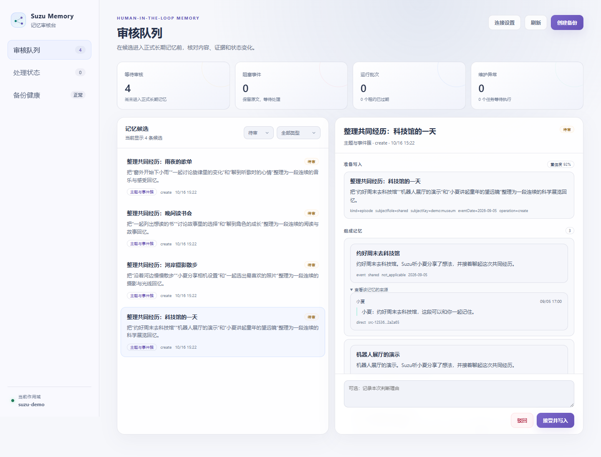
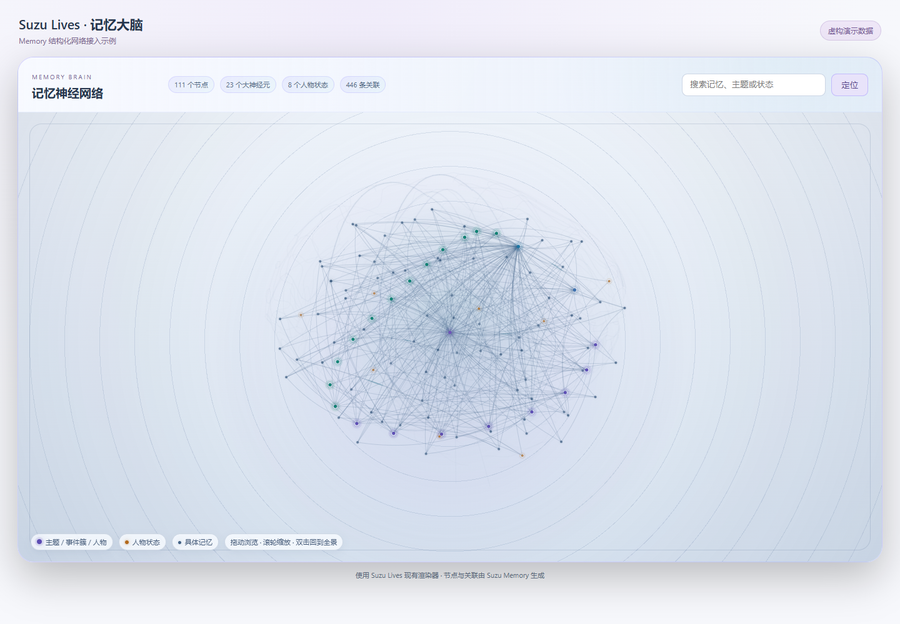
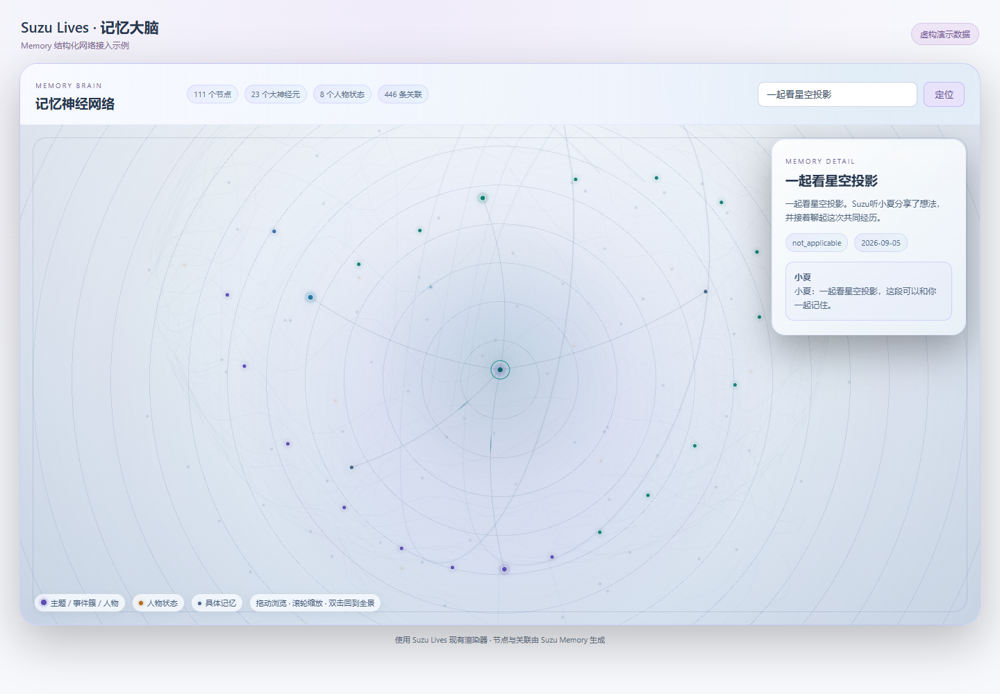

<p align="center">
  <picture>
    <source media="(max-width: 600px)" srcset="docs/assets/hero-mobile.svg">
    
  </picture>
</p>

<p align="center">
  <a href="https://github.com/eryucheng/suzu-memory/actions/workflows/ci.yml"></a>
  <a href="package.json"></a>
  <a href="https://www.sqlite.org/"></a>
  <a href="LICENSE"></a>
</p>

<p align="center">
  <a href="#记忆评测"><strong>记忆评测</strong></a> ·
  <a href="#界面预览"><strong>界面预览</strong></a> ·
  <a href="#快速开始"><strong>快速开始</strong></a> ·
  <a href="#工作机制"><strong>工作机制</strong></a> ·
  <a href="#接入资料"><strong>接入资料</strong></a>
</p>

**Suzu Memory** 是面向持续陪伴型 Agent 的本地优先长期记忆引擎。它把对话与活动整理为相互关联的经历、人物认识和原话证据，供宿主在需要时检索调用。

- **记住经历**：保留人物、时间与来源，连接具体事件、主题和共同经历。
- **理解变化**：区分偏好、习惯、目标和现实条件，用新证据更新认识并保留历史。
- **带着依据召回**：组合多路检索，沿关联展开原话与支持、反对证据，按预算返回上下文。

## 记忆评测

在 ZH-4O 的 **28 组角色扮演对话、1068 道选择题**上，使用相同作答模型比较三种历史信息输入。评测日期：2026-10-26。

| 历史信息 | 正确数 | 总体准确率 |
| --- | ---: | ---: |
| 无历史，仅提供题目与选项 | 754 / 1068 | 70.60% |
| **Suzu Memory 检索记忆** | **956 / 1068** | **89.51%** |
| 完整原始对话 | 992 / 1068 | 92.88% |

记忆组较无历史组提高 **18.91 个百分点**。记忆组的上下文平均为 **632 字符**；完整原文组包含全部对话，不截断。

记忆分析与作答使用 `deepseek-v4-flash`，关闭思考，温度为 `0`，输出上限为 `32768` token；向量模型为 `text-embedding-v4`，维度为 `1024`。记忆上下文上限为 `10976` 字符，其余检索设置使用引擎默认值。

建库仅使用原始对话，标准答案与标注证据只用于评分和审计；检索为只读，每题独立作答。全部 1068 题均计入分母，其中 1 条非 A–D 的原始标注按错计。

[数据准备入口](packages/evaluation/src/zh4o-source-cli.mjs) · [评测入口与参数](packages/evaluation/src/zh4o-system-cli.mjs)

## 界面预览

内置记忆审核台随 HTTP 服务提供，可以核对候选内容、组成记忆和原话证据，按需进行人工复核，也可以查看处理状态与备份健康。

<p align="center">
  <picture>
    <source media="(prefers-color-scheme: dark)" srcset="docs/assets/console-review.png">
    
  </picture>
</p>

<details>
<summary><strong>可视化接入示例：Suzu Lives 三维记忆网络</strong></summary>

Memory 输出人物、主题、事件与状态的结构化网络和三维布局。下面的示例使用 **Suzu Lives 现有的记忆网络渲染器**，展示旋转、缩放、节点定位，以及记忆与原话证据的展开。

<p align="center">
  <picture>
    <source media="(prefers-color-scheme: dark)" srcset="docs/assets/suzu-lives-brain.png">
    
  </picture>
</p>

**定位一条记忆，查看它的原话来源：**

<p align="center">
  <picture>
    <source media="(prefers-color-scheme: dark)" srcset="docs/assets/suzu-lives-brain-focus.png">
    
  </picture>
</p>

</details>

上述截图均使用独立的虚构演示数据。

## 快速开始

需要 **Node.js ≥22.5.0**。

### 安装与配置

```sh
git clone https://github.com/eryucheng/suzu-memory.git
cd suzu-memory
npm ci
cp suzu-memory.example.json suzu-memory.local.json
```

在 `suzu-memory.local.json` 中配置分析模型与 Embedding Provider，并设置 `apiKeyEnv` 指向的密钥环境变量。各字段见[配置示例](suzu-memory.example.json)。

记忆、原始证据与备份保存在本地数据目录；分析和向量化使用你配置的 Provider。

### 运行基础示例

```sh
node examples/basic-host/basic-host.mjs --config ./suzu-memory.local.json
```

示例写入一段虚构对话，执行记忆维护，再查询相关经历。输出包括导入、维护和检索结果，完整调用见[基础示例](examples/basic-host/basic-host.mjs)。

### 启动审核台

```sh
node packages/server/bin/suzu-memory-server.mjs --config ./suzu-memory.local.json
```

默认打开 <http://127.0.0.1:37779/console/>。如果配置了服务 API Key，在页面的“连接设置”中填写。审核台随系统的深浅主题切换。

## 工作机制

**记录经历** `appendEvents` → **后台整理** `runMaintenance` → **按需召回** `search`

宿主写入对话与活动，保留实际发言者、接收 Agent、时间和来源。维护阶段提取事件与事实、分析人物状态，组织经历、主题和证据，并准备检索索引。需要历史材料时，宿主发起查询，引擎在预算内返回上下文、关联片段和相应证据。写入、维护与查询的触发时机由宿主安排。

### 多路检索与证据展开

一个名字、一句原话、一个话题，或相近的表达，都可能帮助找回同一段经历。普通查询组合**词法、BM25、实体与可选向量**线索寻找候选，再结合来源、主体与状态约束组织结果。

<p align="center">
  <picture>
    <source media="(max-width: 600px)" srcset="docs/assets/retrieval-mobile.svg">
    
  </picture>
</p>

可识别的时间查询使用时间分支；传入有效记忆 ID 作为锚点时，可以围绕已有记忆继续展开。

检索可以沿关联关系补充事件上下文和当前认识，也能查阅原话、支持证据与反对证据。接口支持多条候选的可读预览，没有有效材料时返回空结果。调用选项见[接口文档](docs/event-source-contracts.md)，算法实现见[检索器](packages/retriever/src/retriever.mjs)。

### 人物认识的十二个维度

Suzu Memory 用十二类认识组织人物材料，区分本人表达与基于经历的推断，让偏好、目标、关系、现实条件各有自己的位置。例如，“经常加班”描述一段时间的规律；判断工作条件或个人偏好，需要结合对应情境与证据。

<p align="center">
  <picture>
    <source media="(max-width: 600px)" srcset="docs/assets/portrait-mobile.svg">
    
  </picture>
</p>

这些认识可以随着新证据更新。支持与反对证据、情境差异和状态历史共同帮助解释：当时为什么这样理解，现在又发生了什么变化。

### 状态演化与来源追溯

新的交流可以补充、纠正或取代已有认识，原始经历和状态历史仍可追溯。涉及多人时，记忆保留实际参与者及来源空间，同一件事中的不同主体保持各自的归属。

<p align="center">
  <picture>
    <source media="(max-width: 600px)" srcset="docs/assets/lifecycle-mobile.svg">
    
  </picture>
</p>

自然衰减与召回再激活可配置，分别参与排序；详细检索轨迹与激活写入分别控制，激活支持稳定使用身份去重。审核、备份恢复和来源清理接口用于维护长期积累的记忆。

## 接入资料

- **宿主接入**：[基础示例](examples/basic-host/basic-host.mjs)演示完整调用，[聊天宿主示例](examples/chat-host/chat-turn.mjs)演示轮次适配。
- **事件与召回合同**：[Event 来源契约](docs/event-source-contracts.md)说明事件范围、Agent 经历、来源校验、检索选项与清理接口。
- **时间召回**：[日期、模糊时间与排序窗口](docs/temporal-recall.md)说明时区、解析精度、窗口边界与时间权重。
- **输入分批**：[内容长度、前后文与尾批处理](docs/input-batching.md)说明如何累计对话后分批抽取，以及压缩时的收尾调用。
- **检索执行**：[线程、候选预筛与索引缓存](docs/retrieval-execution.md)说明执行选项、索引迁移与资源释放。
- **服务能力**：[服务入口](packages/service/src/index.mjs)提供事件追加、维护、检索、审核、备份与恢复。
- **界面接入**：[审核台页面](packages/console/web/index.html)用于查看候选与运行状态，[可视化数据接口](packages/visualization/src/brain-layout.mjs)提供结构化网络、人物归属和三维布局。

---

[Apache License 2.0](LICENSE) · 作者：儿玉诚也
